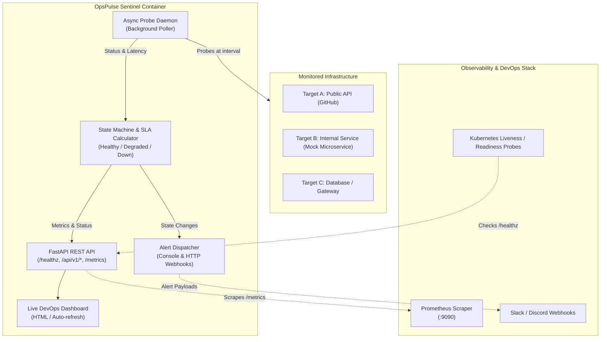
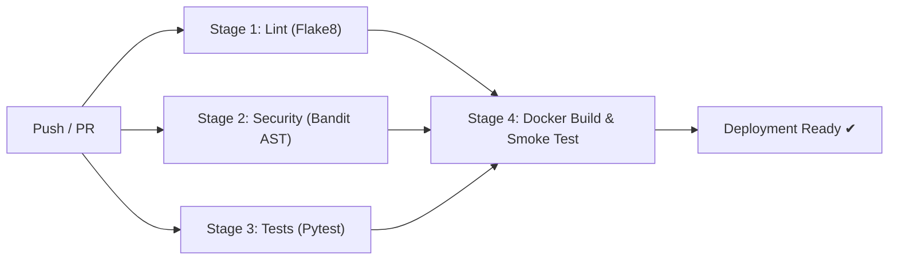

# ⚡ OpsPulse Sentinel

> **A Lightweight Microservice Health & SLA Uptime Sentinel with Automated Alerting, Prometheus Metrics, Multi-Stage Docker, Kubernetes Manifests, and Full CI/CD Pipeline.**

[](https://github.com/example/opspulse/actions)
[](https://www.python.org/)
[](https://www.docker.com/)
[](https://kubernetes.io/)
[](LICENSE)

---

## 📌 Problem Statement

In microservice ecosystems, individual backend services or external dependencies often degrade in performance, experience timeout spikes, or drop offline without triggering immediate warnings. Teams frequently discover downtime only after end users report issues. Heavy enterprise monitoring solutions (such as Datadog or New Relic) can be cost-prohibitive, complex to deploy, or overkill for internal microservices, staging environments, and edge clusters.

### 💡 The Solution: OpsPulse Sentinel
**OpsPulse** is a lightweight, cloud-native DevOps monitoring daemon and API that:
- Periodically executes asynchronous health probes across target URLs.
- Evaluates HTTP status codes, latency thresholds, and consecutive failures.
- Drives a state machine (`HEALTHY` ➔ `DEGRADED` ➔ `DOWN`) with recovery detection.
- Emits real-time alerts via Console and Webhooks (Slack/Discord/Teams compatible).
- Exposes Prometheus metrics at `/metrics` for enterprise Grafana dashboards.
- Provides a clean live dashboard at `/` and REST APIs for orchestration healthchecks (`/healthz`).

---

## 🏗️ Architecture



---

## 📁 Project Structure

```text
.
├── .github/
│   └── workflows/
│       └── ci-cd.yml             # GitHub Actions CI/CD Pipeline (Lint, Scan, Test, Docker)
├── config/
│   ├── targets.yaml              # Target definition (URLs, intervals, thresholds)
│   └── prometheus.yml           # Prometheus scrape configuration
├── k8s/
│   ├── namespace.yaml            # Kubernetes Namespace
│   ├── configmap.yaml            # ConfigMap mounting targets.yaml
│   ├── deployment.yaml           # Deployment (non-root, liveness & readiness probes)
│   └── service.yaml              # ClusterIP Service with Prometheus annotations
├── scripts/
│   └── mock_service.py           # Mock microservice simulating healthy & flaky behaviors
├── src/
│   ├── __init__.py
│   ├── main.py                   # FastAPI Application & Web Dashboard
│   ├── config.py                 # Configuration loader & Pydantic models
│   ├── models.py                 # Data schemas & Enums
│   ├── monitor.py                # Async probe engine & Prometheus metrics
│   └── alert.py                  # Alert dispatcher (Console & Webhooks)
├── tests/
│   ├── __init__.py
│   ├── test_config.py            # Tests for YAML configuration & fallback logic
│   ├── test_monitor.py           # Unit tests for probe logic & state transitions
│   └── test_api.py               # Integration tests for FastAPI endpoints
├── Dockerfile                    # Production multi-stage Docker build (non-root user)
├── docker-compose.yml            # Multi-container stack (OpsPulse + Mock Service + Prometheus)
├── Makefile                      # Standard build automation for Linux/macOS
├── task.ps1                      # Native PowerShell build automation for Windows
├── pytest.ini                    # Pytest configuration
├── requirements.txt              # Core runtime dependencies
├── requirements-dev.txt          # Development, testing, and linting dependencies
└── README.md                     # Documentation
```

---

## 🚀 Quickstart

### 1. Local Development (Windows PowerShell)

```powershell
# Run the test suite
.\task.ps1 test

# Run code style linter (Flake8)
.\task.ps1 lint

# Run security vulnerability audit (Bandit)
.\task.ps1 security

# Start the server locally
.\task.ps1 run
```

### 2. Local Development (Linux / macOS / Git Bash)

```bash
# Install dependencies
make install

# Run tests
make test

# Run linter & security scanner
make lint
make security

# Start local server
make run
```

Visit the dashboard in your browser:
- **Web Dashboard**: [http://localhost:8000](http://localhost:8000)
- **API Swagger Docs**: [http://localhost:8000/docs](http://localhost:8000/docs)
- **Prometheus Metrics**: [http://localhost:8000/metrics](http://localhost:8000/metrics)
- **Health Check**: [http://localhost:8000/healthz](http://localhost:8000/healthz)

---

## 🐳 Docker & Docker Compose Stack

The repository includes a complete multi-container environment with:
1. `opspulse`: The Sentinel daemon and API.
2. `demo-service`: A mock internal microservice with `/health` and `/flaky` endpoints to demonstrate real-time alerts and state changes.
3. `prometheus`: Prometheus v2.51 scraping OpsPulse metrics every 10 seconds.

```bash
# Start the entire monitoring stack
docker compose up --build -d

# Check running services
docker compose ps

# View live container logs
docker compose logs -f opspulse
```

- OpsPulse UI: [http://localhost:8000](http://localhost:8000)
- Prometheus Dashboard: [http://localhost:9090](http://localhost:9090)
- Mock Microservice: [http://localhost:8080/health](http://localhost:8080/health)

---

## ☸️ Kubernetes Deployment

Deploy OpsPulse Sentinel to any Kubernetes cluster (Minikube, Kind, EKS, GKE, AKS):

```bash
# 1. Create monitoring namespace
kubectl apply -f k8s/namespace.yaml

# 2. Deploy ConfigMap with target URLs
kubectl apply -f k8s/configmap.yaml

# 3. Deploy OpsPulse (with rolling updates and non-root security context)
kubectl apply -f k8s/deployment.yaml

# 4. Deploy Service with Prometheus annotations
kubectl apply -f k8s/service.yaml

# Verify deployment status
kubectl get pods -n opspulse-monitoring
```

---

## 🔄 CI/CD Pipeline (GitHub Actions)

The workflow defined in `.github/workflows/ci-cd.yml` runs automatically on every push and pull request to `main`:



1. **Linting**: Enforces PEP 8 standards with Flake8.
2. **Security Scan**: Static Application Security Testing (SAST) via Bandit to prevent common vulnerabilities (CWE).
3. **Automated Testing**: Runs unit & integration test suites with Pytest.
4. **Container Build & Smoke Verification**: Builds the multi-stage Docker image and validates that `/healthz` returns `200 OK`.

---

## 📊 Available API Endpoints

| Method | Endpoint | Description |
|---|---|---|
| `GET` | `/` | Responsive HTML status dashboard (auto-refreshes) |
| `GET` | `/healthz` | Kubernetes Liveness & Readiness probe (returns 200 OK) |
| `GET` | `/api/v1/overview` | Aggregated system health summary (counts, states) |
| `GET` | `/api/v1/targets` | Detailed list of targets, uptime SLA %, and latencies |
| `POST` | `/api/v1/probe` | Triggers an immediate ad-hoc probe cycle |
| `GET` | `/metrics` | Prometheus metrics scrape target |
| `GET` | `/docs` | Interactive Swagger API documentation |

---

## ⚙️ Configuration (`config/targets.yaml`)

```yaml
settings:
  poll_interval_seconds: 15
  request_timeout_seconds: 5.0
  alert_webhook_url: "" # Optional Slack/Discord incoming webhook
  enable_console_alerts: true

targets:
  - id: "github-status"
    name: "GitHub API"
    url: "https://api.github.com"
    method: "GET"
    expected_status: 200
    max_latency_ms: 1000
    critical: true
```

---

## 🛡️ DevOps Best Practices Implemented

- **Least Privilege Security**: Dockerfile runs as an unprivileged user (`appuser:appgroup` with UID/GID 10001); drops all Linux capabilities in Kubernetes.
- **Multi-Stage Docker Builds**: Separates build tooling (gcc, pip wheels) from runtime image to reduce attack surface and image size.
- **Observability**: Native Prometheus metrics (`opspulse_target_up`, `opspulse_target_latency_ms`, `opspulse_target_checks_total`).
- **Resilience**: Kubernetes `livenessProbe` and `readinessProbe` configure self-healing restarts if the container becomes unresponsive.
- **Continuous Integration**: Strict multi-job pipeline ensuring zero code quality regressions.
